  

  
  
  

  

  

## About

My LeetCode practice in Java. Every problem has its own folder with a `README`, `Main.java` and `Solution.java`, sorted into `Easy`, `Medium` and `Hard`. The progress card and the table below update automatically after each solve.

  

<!-- LEETCODE-SYNC:START -->
## Progress

| Easy | Medium | Hard | Total |
| :---: | :---: | :---: | :---: |
| 8 | 8 | 1 | 17 |

## Easy (8)

| # | Title | Topics | Solution | First solved |
| ---: | --- | --- | :---: | :---: |
| 283 | [Move Zeroes](Easy/283.MoveZeroes) | Array, Two Pointers | [Java](Easy/283.MoveZeroes/Solution.java) | 2026-10-31 |
| 345 | [Reverse Vowels of a String](Easy/345.ReverseVowelsOfAString) | Two Pointers, String | [Java](Easy/345.ReverseVowelsOfAString/Solution.java) | 2026-11-01 |
| 392 | [Is Subsequence](Easy/392.IsSubsequence) | Two Pointers, String, Dynamic Programming | [Java](Easy/392.IsSubsequence/Solution.java) | 2026-11-02 |
| 605 | [Can Place Flowers](Easy/605.CanPlaceFlowers) | Array, Greedy | [Java](Easy/605.CanPlaceFlowers/Solution.java) | 2026-10-30 |
| 643 | [Maximum Average Subarray I](Easy/643.MaximumAverageSubarrayI) | Array, Sliding Window | [Java](Easy/643.MaximumAverageSubarrayI/Solution.java) | 2026-11-02 |
| 1071 | [Greatest Common Divisor of Strings](Easy/1071.GreatestCommonDivisorOfStrings) | Math, String, Euclidean Algorithm, Greatest Common Divisor | [Java](Easy/1071.GreatestCommonDivisorOfStrings/Solution.java) | 2026-10-31 |
| 1431 | [Kids With the Greatest Number of Candies](Easy/1431.KidsWithTheGreatestNumberOfCandies) | Array | [Java](Easy/1431.KidsWithTheGreatestNumberOfCandies/Solution.java) | 2026-10-30 |
| 1768 | [Merge Strings Alternately](Easy/1768.MergeStringsAlternately) | Two Pointers, String | [Java](Easy/1768.MergeStringsAlternately/Solution.java) | 2026-10-30 |

## Medium (8)

| # | Title | Topics | Solution | First solved |
| ---: | --- | --- | :---: | :---: |
| 2 | [Add Two Numbers](Medium/2.AddTwoNumbers) | Linked List, Math, Recursion | [Java](Medium/2.AddTwoNumbers/Solution.java) | 2026-10-31 |
| 11 | [Container With Most Water](Medium/11.ContainerWithMostWater) | Array, Two Pointers, Greedy | [Java](Medium/11.ContainerWithMostWater/Solution.java) | 2026-11-02 |
| 151 | [Reverse Words in a String](Medium/151.ReverseWordsInAString) | Two Pointers, String | [Java](Medium/151.ReverseWordsInAString/Solution.java) | 2026-11-01 |
| 334 | [Increasing Triplet Subsequence](Medium/334.IncreasingTripletSubsequence) | Array, Greedy, Longest Increasing Subsequence | [Java](Medium/334.IncreasingTripletSubsequence/Solution.java) | 2026-11-02 |
| 443 | [String Compression](Medium/443.StringCompression) | Two Pointers, String | [Java](Medium/443.StringCompression/Solution.java) | 2026-11-02 |
| 1679 | [Max Number of K-Sum Pairs](Medium/1679.MaxNumberOfKSumPairs) | Array, Hash Table, Two Pointers, Sorting | [Java](Medium/1679.MaxNumberOfKSumPairs/Solution.java) | 2026-11-02 |
| 2095 | [Delete the Middle Node of a Linked List](Medium/2095.DeleteTheMiddleNodeOfALinkedList) | Linked List, Two Pointers | [Java](Medium/2095.DeleteTheMiddleNodeOfALinkedList/Solution.java) | 2026-11-03 |
| 2390 | [Removing Stars From a String](Medium/2390.RemovingStarsFromAString) | String, Stack, Simulation | [Java](Medium/2390.RemovingStarsFromAString/Solution.java) | 2026-11-03 |

## Hard (1)

| # | Title | Topics | Solution | First solved |
| ---: | --- | --- | :---: | :---: |
| 41 | [First Missing Positive](Hard/41.FirstMissingPositive) | Array, Hash Table | [Java](Hard/41.FirstMissingPositive/Solution.java) | 2026-11-01 |

<!-- LEETCODE-SYNC:END -->

  

  Made by <a href="https://github.com/Rishp-3">Rishp-3</a>. Keep solving, one problem at a time.

